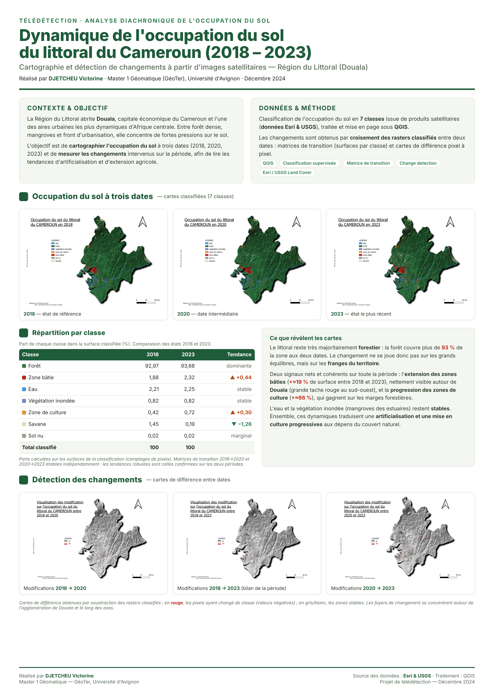

# Dynamique de l'occupation du sol du littoral du Cameroun (2018 – 2023)

Analyse diachronique de l'occupation du sol de la **Région du Littoral** du Cameroun (aire de **Douala**) à partir d'images satellitaires, réalisée sous **QGIS**. Le projet cartographie l'occupation du sol à trois dates (2018, 2020, 2023) et mesure les changements intervenus sur la période.

**Autrice :** DJETCHEU Victorine — Master 1 Géomatique (GéoTer), Université d'Avignon — Décembre 2024.



---

## Objectif

La Région du Littoral concentre à la fois un couvert forestier dense, des mangroves d'estuaire et un front d'urbanisation soutenu autour de Douala, capitale économique du pays. L'objectif est de :

1. cartographier l'occupation du sol en **7 classes** à trois dates ;
2. **quantifier les changements** entre ces dates (matrices de transition) ;
3. **localiser** les zones de changement (cartes de différence).

## Données et méthode

- **Source des données :** produits d'occupation du sol dérivés d'imagerie satellitaire (**Esri & USGS**).
- **Classes (7) :** eau, forêt, végétation inondée, zone de culture, zone bâtie, sol nu, savane.
- **Traitement et mise en page :** QGIS 3.34.
- **Détection de changements :** croisement des rasters classifiés entre deux dates — matrices de transition (surfaces par classe) et cartes de différence pixel à pixel.

## Résultats — répartition par classe

Part de chaque classe dans la surface classifiée (en %, à partir des comptages de pixels des matrices de transition) :

| Classe | 2018 | 2023 | Tendance |
|---|---:|---:|---|
| Forêt | 92,97 | 93,68 | classe dominante |
| Zone bâtie | 1,88 | 2,32 | **en hausse** (+≈19 % de surface) |
| Eau | 2,21 | 2,25 | stable |
| Végétation inondée | 0,82 | 0,82 | stable |
| Zone de culture | 0,42 | 0,72 | **en hausse** (+≈66 % de surface) |
| Savane | 1,45 | 0,19 | en recul |
| Sol nu | 0,02 | 0,02 | marginal |

> Les matrices de transition 2018→2020 et 2020→2023 ont été établies indépendamment. Les tendances les plus fiables sont celles confirmées sur les deux périodes : l'extension des zones bâties et des zones de culture.

## Lecture

Le littoral reste très majoritairement **forestier** (> 93 % aux deux dates) : les grands équilibres bougent peu, le changement se joue sur les franges du territoire. Deux dynamiques ressortent nettement et de façon cohérente sur toute la période :

- l'**extension des zones bâties**, visible autour de l'agglomération de Douala ;
- la **progression des zones de culture**, qui gagnent sur les marges forestières.

L'eau et la végétation inondée (mangroves) restent stables. L'ensemble traduit une **artificialisation et une mise en culture progressives** aux dépens du couvert naturel.

## Contenu du dépôt

```
.
├── Poster_occupation_sol_littoral_Cameroun.pdf   # poster final (impression)
├── Poster_occupation_sol_littoral_Cameroun.png   # aperçu
├── cartes/
│   ├── occupation/        # cartes classifiées 2018, 2020, 2023
│   └── changements/       # cartes de différence entre dates
└── donnees/
    ├── matrice_transition_2018_2020.ods
    └── matrice_transition_2020_2023.ods
```

## Outils

QGIS · Classification de l'occupation du sol · Matrices de transition · Détection de changements (change detection) · Données Esri / USGS.
